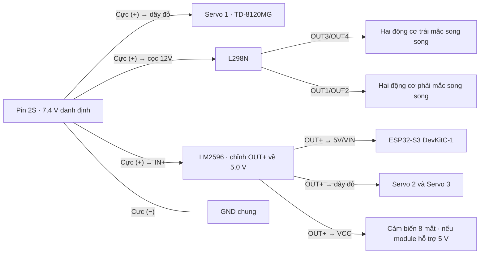

# ESP32-S3 Robot Line Tracker + L298N (4 Motors) + 3 Servos + Bluefruit BLE

Dự án firmware hoàn chỉnh trên nền tảng **PlatformIO** cho vi điều khiển **ESP32-S3 WROOM-1 (DevKitC-1)**.

## 📌 Tính Năng Nổi Bật

- **Điều khiển 4 động cơ qua mạch cầu H L298N (Đúng sơ đồ thực tế):**
  - 2 động cơ bên **TRÁI** đấu song song vào cọc `OUT3 & OUT4` (điều khiển bởi ENB, IN3, IN4).
  - 2 động cơ bên **PHẢI** đấu song song vào cọc `OUT1 & OUT2` (điều khiển bởi ENA, IN1, IN2).
  - Nếu hai bên xe đã đấu vào hai kênh ngược với sơ đồ trên, đặt `SWAP_LEFT_RIGHT_MOTORS` thành `true` trong `include/config.h`.
  - Điều khiển tốc độ mượt mà bằng xung PWM tần số 10kHz (sử dụng ngoại vi phần cứng LEDC của ESP32-S3).
- **Cấp nguồn từ pin 2S 7,4 V**
  - Pin cấp trực tiếp cho **Servo 1 TD-8120MG** và cọc nguồn động lực của **L298N**. Cọc 5 V của L298N để trống.
  - Mạch **LM2596** hạ xuống **5,0 V** để cấp cho ESP32-S3, Servo 2, Servo 3 và cảm biến dò line 8 mắt.
  - Tất cả các nhánh nối chung GND. Xem giới hạn điện áp của Servo 1 ở phần [đấu nối servo](docs/wiring.md#33-đấu-nối-3-động-cơ-servo).
- **Tự động bám VIỀN ranh giới Đen - Trắng (Edge Tracking):**
  - Không phải chạy đè lên giữa vạch đen, robot bám chính xác vào **đường viền chuyển tiếp giữa mặt sàn Trắng và vùng Đen**.
  - Nhận diện vị trí ranh giới chuyển đổi (0 -> 1 hoặc 1 -> 0) với độ nhạy cao.
  - Tự động nhận diện khi xe bị văng hẳn vào vùng toàn Trắng hoặc toàn Đen để tự lượn quay trở lại mép viền.
- **An toàn khi khởi động (Nút 1 bắt đầu):**
  - Khi bật nguồn xe, 4 động cơ **HOÀN TOÀN DỪNG YÊN** ở chế độ chờ (Standby).
  - Kết nối app Bluetooth và bấm **Nút 1** trên Control Pad thì xe mới bắt đầu xuất phát dò viền. Bấm lại nút 1 bất kỳ lúc nào để phanh dừng khẩn cấp.
- **3 động cơ servo điều khiển độc lập**
  - **Servo 1 (GPIO 14):** Tối ưu chuẩn Datasheet dòng servo kỹ thuật số tải nặng **TD-8120MG (20kg.cm)**:
    + Dải độ rộng xung cực đại: **`500µs - 2500µs`** (Neutral `1500µs`).
    + Góc quay mở rộng: **`0° - 270°`** (đẩy kịch 100% cơ cấu hành trình, không còn bị khựng ở 180° hay 66% hành trình).
    + Hỗ trợ đặt xung trực tiếp (`servo1_setMicroseconds`), đặt góc (`servo1_setAngle`) và đặt phần trăm hành trình (`servo1_setPercent`).
    + Điều khiển bật/tắt hành trình trực tiếp qua **Nút 2** trên Controller Pad hoặc gõ lệnh qua UART.
  - **Servo 2 (GPIO 21):** Header & file độc lập `servo2.cpp` (Nút 3).
  - **Servo 3 (GPIO 47):** Header & file độc lập `servo3.cpp` (Nút 4).
- **Truyền trạng thái 8 mắt cảm biến trực tiếp về giao diện App BLE:**
  - Tab **UART / Terminal** trên app Adafruit Bluefruit LE Connect hiển thị liên tục trạng thái thời gian thực của 8 mắt: `R:11000011 [..####..] E:+0.0`.
  - Giúp quan sát ngay lập tức phản xạ của từng mắt đọc khi di chuyển xe qua vạch đen và nền trắng mà không cần cắm cáp USB vào máy tính.
  - Hỗ trợ đổi mức logic Đen=HIGH / Đen=LOW tức thì (gõ `I`) và bật/tắt trở kéo `INPUT_PULLUP` (gõ `P`).
- **Điều khiển không dây qua Bluetooth Low Energy (Adafruit Bluefruit LE Connect):**
  - Tương thích 100% với app **Adafruit Bluefruit LE Connect** trên iOS & Android.
  - Hỗ trợ chuyển đổi linh hoạt 2 chế độ: Tự động dò line (`LINE TRACKING`) hoặc Điều khiển từ xa bằng điện thoại (`MANUAL BLE`).
  - Hỗ trợ bàn phím Control Pad (D-Pad tiến, lùi, rẽ, dừng khi thả nút) và gửi lệnh qua UART Terminal.
- **Tài liệu đấu nối chi tiết:**
  - Xem tài liệu đầy đủ tại [docs/wiring.md](docs/wiring.md).

---

## Sơ đồ đấu nối



Nối **cực âm pin**, `IN−/OUT−` của LM2596, GND của ESP32-S3, L298N, cảm biến và dây nâu/đen của cả ba servo về **GND chung**. Để trống cọc `5V` trên L298N và tháo hai jumper `ENA/ENB` để nhận PWM từ ESP32-S3. Kiểm tra Servo 1 chịu được điện áp pin khi sạc đầy trước khi đấu trực tiếp. [Chi tiết nguồn và jumper](docs/wiring.md)

### Chân tín hiệu ESP32-S3

| Bộ phận | Chân thiết bị | GPIO tương ứng theo thứ tự |
| :--- | :--- | :--- |
| L298N — động cơ phải | `ENA`, `IN1`, `IN2` | `8`, `9`, `10` |
| L298N — động cơ trái | `ENB`, `IN3`, `IN4` | `13`, `11`, `12` |
| Servo 1, Servo 2, Servo 3 | Dây tín hiệu của từng servo | `14`, `21`, `47` |
| Cảm biến — bốn mắt bên trái | `D1`, `D2`, `D3`, `D4` | `4`, `5`, `6`, `7` |
| Cảm biến — bốn mắt bên phải | `D5`, `D6`, `D7`, `D8` | `15`, `16`, `17`, `18` |
| Cảm biến — bật đèn hồng ngoại | `IR/1R`, nếu module có ngõ enable tương thích | `1` |

Nhìn theo hướng xe chạy, **D1/S1 ở ngoài cùng bên trái** và **D8/S8 ở ngoài cùng bên phải**. Kiểm tra tín hiệu `D1–D8` tương thích mức logic **3,3 V** trước khi nối vào GPIO. [Datasheet ESP32-S3](https://documentation.espressif.com/esp32-s3_datasheet_en.pdf)

---

## 📂 Cấu Trúc Dự Án

```
ball_itch/
├── docs/
│   └── wiring.md             # Hướng dẫn đấu nối phần cứng, nguồn điện và cấu hình app
├── include/
│   ├── config.h              # Cấu hình chân GPIO, tần số PWM, tham số PID, BLE
│   ├── motor_driver.h        # Khai báo hàm điều khiển 4 động cơ L298N
│   ├── line_sensor.h         # Khai báo hàm đọc và tính toán 8 mắt dò line
│   ├── servo1.h              # Header điều khiển riêng biệt cho Servo 1 (GPIO 14)
│   ├── servo2.h              # Header điều khiển riêng biệt cho Servo 2 (GPIO 21)
│   ├── servo3.h              # Header điều khiển riêng biệt cho Servo 3 (GPIO 47)
│   └── ble_controller.h      # Khai báo module Bluetooth Low Energy Bluefruit
├── src/
│   ├── motor_driver.cpp      # Hiện thực điều khiển tốc độ và hướng động cơ
│   ├── line_sensor.cpp       # Hiện thực thuật toán đọc cảm biến và gán trọng số
│   ├── servo1.cpp            # Mã nguồn điều khiển Servo 1 (nơi thêm logic sau này)
│   ├── servo2.cpp            # Mã nguồn điều khiển Servo 2 (nơi thêm logic sau này)
│   ├── servo3.cpp            # Mã nguồn điều khiển Servo 3 (nơi thêm logic sau này)
│   ├── ble_controller.cpp    # Hiện thực giao thức Nordic UART Service cho Bluefruit
│   └── main.cpp              # Vòng lặp chính điều phối toàn bộ hệ thống
├── platformio.ini            # File cấu hình PlatformIO (board esp32-s3-devkitc-1)
└── README.md                 # Giới thiệu dự án
```

---

## 🚀 Hướng Dẫn Biên Dịch & Nạp Code

### 1. Cài đặt PlatformIO

Đảm bảo bạn đã cài đặt extension **PlatformIO IDE** trong VS Code hoặc cài đặt qua dòng lệnh `pio`:

```bash
pip install platformio
```

### 2. Biên dịch dự án (Build)

Mở terminal trong thư mục dự án và chạy:

```bash
pio run
```

### 3. Nạp code vào ESP32-S3 (Upload)

Kết nối ESP32-S3 với máy tính qua cổng USB và chạy:

```bash
pio run --target upload
```

### 4. Mở Serial Monitor để quan sát

```bash
pio device monitor -b 115200
```

---

## 🎮 Hướng Dẫn Sử Dụng App Bluefruit LE & Kiểm Tra Cảm Biến

1. Tải ứng dụng **Adafruit Bluefruit LE Connect** trên iOS hoặc Android.
2. Mở Bluetooth điện thoại, quét và bấm Connect vào thiết bị **xe dò line** (luôn bật sẵn, không cần mã PIN).
3. **Tab UART / Terminal (Theo dõi & Cân chỉnh Cảm biến trực tiếp):**
   - Màn hình sẽ tự động cập nhật liên tục mỗi 300ms trạng thái 8 mắt:
     ```
     R:11000011 [..####..] E:+0.0
     ```
     - `R:11000011`: Mức logic điện áp thực tế đọc từ 8 chân GPIO (S1..S8).
     - `[..####..]`: Trạng thái giải mã trực quan (`#` = Vạch đen, `.` = Nền trắng).
     - `E:+0.0`: Vị trí mép viền gần tâm trong mẫu hiển thị (-3.0 đến +3.0). Các mẫu khác có thể báo `ALL_WHITE`, `ALL_BLACK`, `CROSS` hoặc `NO_EDGE`.
   - **Các lệnh tương tác nhanh (gõ vào ô gửi văn bản trong tab UART):**
     - `?` hoặc `H`: Trả về báo cáo chẩn đoán chi tiết từng chân GPIO, mức điện áp, logic hiện hành.
     - `I`: Đảo mức logic bắt vạch đen (`HIGH` <-> `LOW`). Dùng ngay khi mắt đọc nhận diện ngược.
     - `P`: Bật / Tắt trở kéo nội `INPUT_PULLUP` trên 8 chân GPIO.
     - `T`: Tạm dừng hoặc tiếp tục luồng phát Telemetry trực tiếp.
     - `V`: Chuyển giữa trắng trái, đen trái và tự chọn viền.
     - `+`, `-`: Chỉnh tốc độ cơ bản khi bám viền.
     - `1`: Bắt đầu / Tạm dừng chế độ dò viền.
     - `2`: Kích hoạt Servo 1 (TD-8120MG) đẩy kịch 100% hành trình (270 độ / 2500µs).
     - `3`, `4`: Kích hoạt Servo 2, Servo 3.
4. **Tab Controller -> Control Pad:**
   - **Nút 1**: Khởi động / Tạm dừng dò viền (Edge Tracking).
   - **Nút 2**: Điều khiển Servo 1 (TD-8120MG trên chân 14) gạt hết 100% hành trình.
   - **Nút 3, 4**: Test Servo 2 và Servo 3.
   - **D-Pad (Mũi tên lên, xuống, trái, phải)**: Lái xe thủ công khi ở chế độ Standby.

### Cân chỉnh tốc độ thấp và bám viền

- Mỗi bên động cơ nhận ít nhất `245/255` trong 120 ms đầu khi khởi hành, sau đó về PWM được yêu cầu với sàn `165/255`. Tốc độ bám viền cơ bản là `185/255` và chế độ tay là `220/255`. Các mức này nằm trong `include/config.h`.
- Kê bánh lên khỏi sàn và thử nhấn mũi tên lên trong Standby. Nếu bánh vẫn đứng và động cơ chỉ kêu, thả nút rồi kiểm tra bánh hoặc hộp số bị kẹt, điện áp tại cọc cấp nguồn L298N lúc đề-pa và chiều quay của hai bánh trên mỗi bên.
- Mắt đọc cách sàn **1 mm (0,1 cm)**. Kiểm tra thanh cảm biến không cạ sàn, rồi đặt mép vạch giữa S4 và S5. Dùng `V` để chọn đúng phía màu đen và `I` nếu trạng thái `#` và `.` trong app bị đảo. Khi mất viền, xe tìm lại tối đa 750 ms rồi dừng. Xe tiếp tục khi cảm biến thấy lại mép hợp lệ.
- Kiểm tra hướng rẽ bằng hai nút **←** và **→** trong Standby. Khi đưa vạch đen vào hai mắt ngoài cùng bên trái, dãy cảm biến trong UART sẽ hiện `[##......]`. Nếu chỉ còn thấy mép ngược với chế độ bám viền đã chọn, xe tìm về phía còn thấy màu đen.
# my-ball-itch

